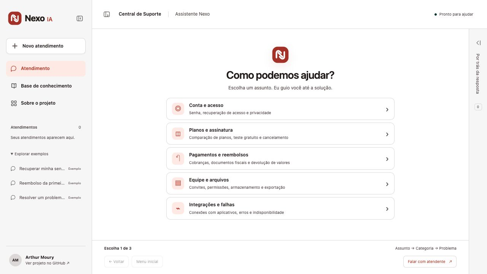
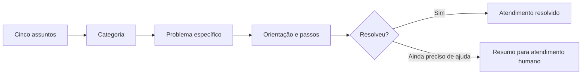

<p align="center"></p>
<h1 align="center">Nexo IA</h1>
<p align="center">Atendimento guiado por opções, do assunto inicial à solução do problema.</p>
<p align="center"><a href="https://nexo-suporte-arthurmoury.netlify.app">Experimentar o atendimento</a> · <a href="docs/architecture.md">Arquitetura</a> · <a href="docs/evaluation.md">Avaliação</a></p>
<p align="center">  </p>



## O atendimento começa com uma escolha

Você não precisa escrever uma mensagem nem saber como explicar seu problema. O assistente oferece cinco assuntos. Cada um abre categorias, que levam a situações específicas e a uma orientação com passos claros.

O cenário é a **Nexo**, uma loja fictícia de assinaturas do Nexo Workspace, software para pequenas equipes. Preços, políticas, organizações e chamados foram criados para o projeto.

| Assunto | Categorias | Exemplos de problemas |
|---|---|---|
| Conta e acesso | Recuperação, privacidade e dados | Senha esquecida, link expirado, exclusão de dados |
| Planos e assinatura | Escolha e gestão do plano | Comparar recursos, testar o Pro, cancelar |
| Pagamentos e reembolsos | Cobranças, documentos e devoluções | Cobrança duplicada, nota fiscal, prazo de reembolso |
| Equipe e arquivos | Pessoas, permissões e conteúdo | Convite expirado, upload, exportação CSV |
| Integrações e falhas | Conexões e problemas técnicos | Google Agenda, aplicativos não disponíveis, erro e lentidão |

O fluxo contém **24 situações com soluções cadastradas**, vinculadas a **13 artigos de suporte**.

## Uma conversa conduzida por botões



Exemplo: **Conta e acesso → Recuperar meu acesso → Esqueci minha senha**.

O assistente mostra a orientação correspondente e a política usada. Você confirma a resolução ou prepara um resumo para continuar com uma pessoa. Também pode voltar uma etapa, retornar ao menu inicial ou pedir atendimento humano a qualquer momento.

- Somente as opções da etapa atual ficam disponíveis.
- O histórico permite reabrir o caminho e continuar após atualizar a aba.
- As conversas de exemplo estão identificadas e podem ser exploradas.
- A barra lateral abre e fecha com animação e funciona como menu deslizante no celular.
- O painel “Por trás da resposta” começa recolhido e mostra as escolhas e fontes consultadas.
- O resumo humano inclui o caminho completo, sem exigir dados pessoais.

O resumo é um rascunho para copiar. Não há envio de mensagem, abertura real de chamado, cancelamento de plano ou execução de reembolso. O contato `suporte@nexo.example` é demonstrativo.

## Fluxo controlado e API experimental de IA

**O atendimento publicado usa uma árvore de decisões e soluções cadastradas. Ele não faz chamadas ao modelo de IA.** As escolhas e políticas são processadas no navegador. Esta arquitetura corresponde a um chatbot de atendimento guiado, sem autonomia de um LLM.

O repositório também conserva uma **API experimental separada**, em JavaScript e Netlify Functions. Em `/api/chat`, um modelo pode escolher ferramentas e selecionar fontes, ou usar uma referência determinística sem modelo. Essa API continua disponível para estudo, com benchmark em Python e juiz semântico opcional, mas não é chamada pelos botões do atendimento.

Essa separação permite estudar tanto o comportamento previsível de um fluxo quanto a avaliação de uma integração com modelo. Veja [Arquitetura](docs/architecture.md).

## Executar localmente

Requisitos: Node.js 22 ou superior e Python 3.10 ou superior para o benchmark. Não há dependências de runtime de terceiros.

```sh
git clone https://github.com/ArthurMoury/nexo-suporte-ia.git
cd nexo-suporte-ia
npm ci
npm run dev
```

Abra [localhost:4173](http://127.0.0.1:4173). O atendimento guiado funciona sem credenciais de IA.

## Editar os assuntos e as soluções

[data/support-flow.json](data/support-flow.json) define os assuntos, categorias e problemas. Cada problema informa `articleId`, uma introdução, os passos da solução e se precisa de análise humana. [data/knowledge.json](data/knowledge.json) reúne as políticas e os registros fictícios.

```json
{
  "id": "meu-problema",
  "label": "Descrição que a pessoa reconhece",
  "articleId": "acesso",
  "solution": {
    "intro": "Orientação aprovada para esse caso.",
    "steps": ["Primeiro passo.", "Segundo passo."]
  },
  "needsHuman": false
}
```

Mantenha as orientações coerentes com as políticas. Cada ID precisa ser único, cada menu precisa de opções e cada problema precisa de uma solução com fonte válida. Os testes percorrem todas as 24 situações e verificam esses contratos.

## Qualidade e regressão

```sh
npm run check
```

A verificação atual executa **18 testes em JavaScript**, **24 casos do benchmark determinístico em Python** e o build. Os testes novos cobrem todos os caminhos do fluxo, restauração e retorno de etapas, referências inválidas, IDs duplicados, prazo de reembolso e rascunho humano.

O benchmark Python de perguntas e respostas avalia a API experimental. Ele não deve ser apresentado como uma avaliação semântica da nova árvore de atendimento. Os testes de caminhos verificam a estrutura e os contratos do fluxo, não a eficácia com clientes reais.

O GitHub Actions executa as verificações a cada push. O juiz semântico em Python é opcional, usa chamadas de API que podem consumir créditos e exige calibração humana. Veja [o guia de avaliação](docs/evaluation.md) e [o registro de verificação](docs/verification.md).

## Histórico e dados

O histórico guiado guarda até 12 atendimentos no `sessionStorage` da aba: caminho escolhido e situação de cada atendimento. Ele pode ser reaberto após recarregar e não é sincronizado com uma conta. Sem armazenamento disponível, a interface mantém o histórico em memória. Os dados de sessão da interface anterior não são sobrescritos pelo novo fluxo.

O atendimento não solicita texto livre, senhas, cartão ou dados pessoais. Os artigos, três organizações e três chamados de exemplo são públicos e inteiramente fictícios.

## Publicação

A demonstração está na [Netlify](https://nexo-suporte-arthurmoury.netlify.app). O arquivo `netlify.toml` configura o build, `dist/` e as funções. O deploy atual é manual, enquanto o CI verifica a qualidade do código.

```sh
npx netlify-cli deploy --prod --build
```

Para publicar sua cópia, vincule a CLI ao seu próprio projeto Netlify ou importe o repositório na plataforma.

Apenas o uso da API experimental de IA pode consumir créditos de modelo. Ela aceita `OPENAI_API_KEY`, `OPENAI_BASE_URL` e `OPENAI_MODEL`, somente no servidor. Sem credenciais, retorna a referência determinística. `DISABLE_AI=true` desliga o modelo. O atendimento por opções não depende dessas variáveis. Consulte [.env.example](.env.example).

## Estrutura

```text
 data/support-flow.json      Árvore de assuntos, problemas e soluções
 data/knowledge.json         Políticas e registros fictícios
 public/app.js               Conversa guiada, histórico e navegação
 public/support-flow.js      Validação de caminhos e geração de resumos
 src/engine.mjs              Controlador da API experimental de IA
 netlify/functions/chat.mjs  API de mensagens separada da interface
 evaluation/                 Benchmark e juiz semântico em Python
 tests/                      Contratos do fluxo e da API
 docs/                       Arquitetura, avaliação e capturas
```

## Limites

Um problema fora das opções precisa de atendimento humano ou de uma atualização do fluxo. O chatbot não interpreta texto livre na interface e não acessa contas ou sistemas externos. A base, as soluções e os benchmarks são sintéticos. Antes de atender clientes reais, são necessárias políticas revisadas, canais funcionais, autorização, privacidade e avaliação com pessoas.

Desenvolvido com assistência de IA a partir da proposta de [Arthur Moury](https://github.com/ArthurMoury). Código e dados de exemplo sob [licença MIT](LICENSE).
