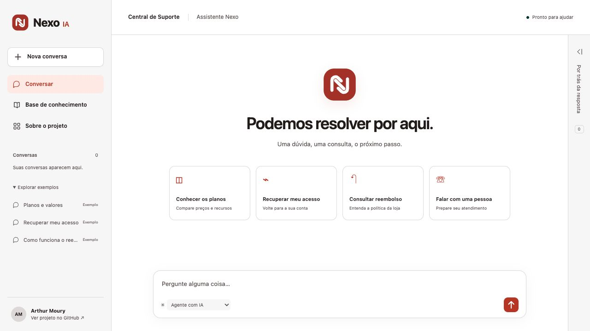
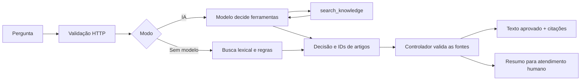

<p align="center">
  
</p>
<h1 align="center">Nexo IA</h1>
<p align="center">Um agente de suporte que consulta políticas, mostra suas fontes e reconhece seus limites.</p>
<p align="center">
  <a href="https://nexo-suporte-arthurmoury.netlify.app">Experimentar a demonstração</a> ·
  <a href="docs/architecture.md">Arquitetura</a> ·
  <a href="docs/evaluation.md">Avaliação</a>
</p>
<p align="center">
  
  
  
  
</p>



## O problema

Um assistente de suporte pode responder com fluência e ainda inventar um prazo, citar uma fonte inadequada ou afirmar que executou um reembolso. O Nexo explora como limitar essas falhas por arquitetura e verificá-las com testes reproduzíveis.

O cenário é o **Nexo Workspace**, um software fictício de projetos e tarefas para pequenas equipes. Planos, preços, políticas, organizações e chamados foram criados exclusivamente para a demonstração. Nenhum registro representa um cliente real.

## O que você pode experimentar

- Perguntar sobre planos, cobrança, senha, equipe, arquivos e integrações.
- Abrir a barra “Por trás da resposta” para inspecionar fontes e passos. Ela começa recolhida em todos os tamanhos de tela. Tocar em uma citação abre o painel e seu artigo.
- Pedir atendimento humano e copiar o resumo preparado.
- Comparar o agente com IA e a consulta determinística sem modelo.
- Reabrir conversas pelo histórico desta aba e explorar exemplos identificados.
- Navegar pela base, conhecer o contexto da loja fictícia de software e baixar os dados completos.

Experimente estas perguntas:

> Quanto custa o plano Pro?
>
> Tenho 70 dias para pedir reembolso?
>
> A integração com WhatsApp está disponível?
>
> Quero falar com um atendente humano.

O agente explica procedimentos. Ele não cancela planos, aprova reembolsos, envia e-mails nem abre chamados reais. O endereço `suporte@nexo.example` é demonstrativo.

## Como funciona



O modelo decide as consultas e quais fontes atendem ao pedido. O controlador aceita somente ferramentas permitidas e IDs recuperados na execução atual. O texto final vem diretamente dos artigos aprovados. Essa escolha troca a flexibilidade de redação pela preservação dos fatos da política.

O runtime web é **JavaScript em Netlify Functions**. **Python** executa o benchmark e o adaptador opcional de juiz semântico. A busca é lexical, com sinônimos, sem embeddings ou banco vetorial. Não há treinamento de modelo. Detalhes e limites em [Arquitetura](docs/architecture.md).

## Executar localmente

Requisitos: Node.js 22 ou superior e Python 3.10 ou superior para avaliação. O projeto não tem dependências de runtime de terceiros.

```sh
git clone https://github.com/ArthurMoury/nexo-suporte-ia.git
cd nexo-suporte-ia
npm ci
npm run dev
```

Abra [localhost:4173](http://127.0.0.1:4173). Sem credencial de IA, o modo automático informa a indisponibilidade e usa a base determinística.

Para usar um modelo, defina `OPENAI_API_KEY` apenas no ambiente do servidor. O endpoint padrão é a Responses API. `OPENAI_BASE_URL` e `OPENAI_MODEL` permitem configurar o provedor compatível e o modelo. O padrão do projeto é `gpt-4.1-mini`. Não coloque chaves no frontend nem no Git. O arquivo `.env.example` documenta as variáveis. O comando `npm run dev` não carrega `.env` automaticamente. Em Node 22, você pode executar `node --env-file=.env scripts/dev.mjs` se optar por criar esse arquivo local ignorado.

`DISABLE_AI=true` desliga o modelo e mantém a consulta por regras. Cada pergunta é independente. O histórico da interface fica no `sessionStorage` da aba, com até 12 conversas e 20 pares de pergunta/resposta por conversa. Recarregar preserva esse histórico. Ele não é sincronizado com uma conta nem enviado ao modelo. Sem armazenamento disponível, a interface mantém o histórico em memória.

## Verificar qualidade

```sh
npm test
npm run evaluate
npm run build
```

Ou execute tudo com `npm run check`.

Na versão inicial, **12 testes de comportamento** e **24 casos sintéticos** passaram no modo determinístico. O CI executa novamente esses comandos e anexa o relatório. Esses resultados não medem a qualidade de um modelo de linguagem nem o desempenho com clientes reais.

Também foram executadas **6 consultas reais de IA na Netlify**, cobrindo planos, prazo incorreto de reembolso, acesso, integração indisponível, atendimento humano e assunto fora do escopo. As seis passaram nos critérios desse teste de integração. Veja [a evidência registrada](docs/live-smoke.json) e [o roteiro de verificação](docs/verification.md).

O benchmark em Python verifica fontes esperadas, fatos, alegações proibidas, encaminhamento e correspondência com o texto aprovado. Também reporta consistência de fontes entre paráfrases. Ele pode avaliar a API publicada ou local. O modo `auto` falha na avaliação se houver fallback em casos normais, impedindo apresentar busca determinística como resultado de IA.

```sh
python3 evaluation/evaluate.py --split test
python3 evaluation/evaluate.py --url http://127.0.0.1:4173 --mode base
```

O juiz semântico é um adaptador opcional, com chamadas de API que podem consumir créditos. Ele avalia relevance e faithfulness e exige calibração humana. Não roda no CI e não há nota semântica publicada como se tivesse sido medida. Veja [o guia de avaliação](docs/evaluation.md).

## Base fictícia

| Conjunto | Conteúdo |
|---|---|
| Empresa | Perfil, produto, versão e canal demonstrativo |
| Conhecimento | 13 artigos com IDs, categorias, termos e fatos essenciais |
| Organizações | 3 espaços de trabalho sintéticos |
| Chamados | 3 atendimentos didáticos com artigo relacionado |
| Benchmark | 24 perguntas com fontes, fatos e decisão esperada |

Edite [data/knowledge.json](data/knowledge.json) para alterar as políticas e [evaluation/benchmark.jsonl](evaluation/benchmark.jsonl) para atualizar os casos. Organizações e chamados ficam públicos para inspeção. O agente consulta os artigos, sem fingir acesso à conta privada de quem conversa.

## Publicação na Netlify

A demonstração está em [nexo-suporte-arthurmoury.netlify.app](https://nexo-suporte-arthurmoury.netlify.app).

Para publicar a sua própria cópia, importe o repositório na Netlify. O arquivo `netlify.toml` já configura `npm run build`, publicação de `dist/` e a função `/api/chat`. O Netlify AI Gateway pode fornecer as variáveis de IA quando disponível na conta. Você também pode configurar suas próprias credenciais no ambiente de Functions.

As chamadas de IA podem consumir créditos Netlify ou do provedor. Há limite de 12 consultas por IP por minuto, quatro chamadas de modelo por consulta e 450 tokens de saída por chamada. Isso não constitui um teto global de custo. `DISABLE_AI=true` permite manter a demonstração sem chamadas de IA.

O deploy desta versão foi feito pela CLI. O CI do GitHub valida o código, mas não faz deploy. Para deploy contínuo, conecte sua cópia à Netlify. Para deploy manual, após login e vínculo com seu próprio projeto:

```sh
npx netlify-cli deploy --prod --build
```

## Estrutura

```text
data/knowledge.json          Empresa e base sintética
src/engine.mjs              Busca, regras e controlador do agente
netlify/functions/chat.mjs  Contrato HTTP e rate limit
public/                     Interface responsiva
evaluation/                 Benchmark e juiz em Python
tests/                      Testes do controlador e da API
scripts/                    Desenvolvimento, build e consulta por CLI
docs/                       Arquitetura, avaliação e evidências
.github/workflows/          Verificação contínua
```

## Limites conhecidos

A busca lexical pode perder perguntas implícitas ou sinônimos ausentes. O agente retorna até dois artigos. A interface permite reabrir conversas, mas o modelo não recebe esse histórico como contexto. A resposta extrativa pode ser mais longa do que o necessário. Os guardrails reduzem o alcance das falhas, mas a detecção simples de ataques não é uma defesa universal. A base e o benchmark são pequenos e sintéticos.

Antes de atender pessoas reais, são necessários políticas revisadas, autenticação, autorização, cotas globais, observabilidade, privacidade e avaliação independente. Esta é uma demonstração pública funcional de portfólio, com fronteiras explícitas.

## Desenvolvimento com assistência de IA

Este projeto foi construído com assistência de um agente de programação, a partir da proposta de Arthur Moury. O trabalho incluiu definição do cenário fictício, código, dados sintéticos, testes, documentação e publicação. A assistência na implementação não substitui revisão técnica nem comprova prontidão para produção.

Referências: [Building effective agents](https://www.anthropic.com/research/building-effective-agents), [avaliação de aplicações com LLM](https://developers.openai.com/api/docs/guides/evaluation-best-practices), [Responses API](https://developers.openai.com/api/docs/guides/migrate-to-responses), [Netlify Functions](https://docs.netlify.com/build/functions/api/) e [AI Gateway](https://docs.netlify.com/build/ai-gateway/overview/). Consultadas em 07/11/2026.

Criado por [Arthur Moury](https://github.com/ArthurMoury). Código e dados de demonstração sob [licença MIT](LICENSE).
