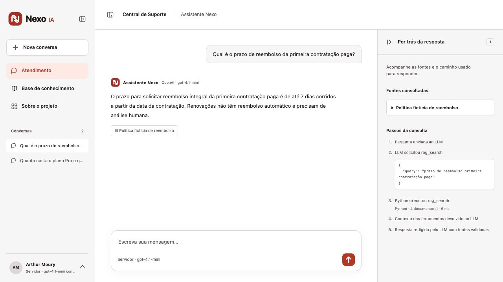
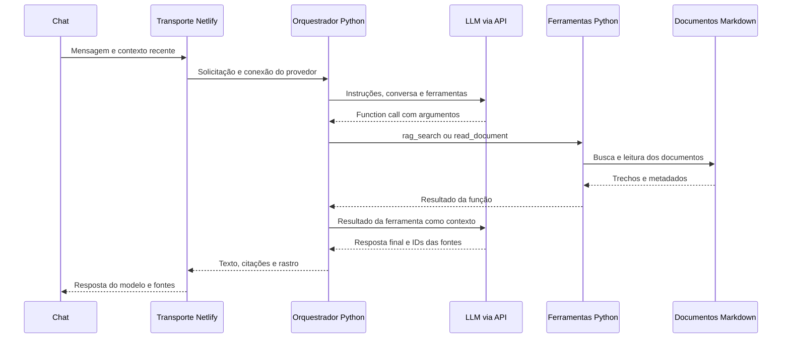

<p align="center"></p>
<h1 align="center">Nexo IA</h1>
<p align="center">Chat com LLM via API, tool calling em Python e RAG sobre documentos de suporte.</p>
<p align="center"><a href="https://nexo-suporte-arthurmoury.netlify.app">Conversar com o agente</a> · <a href="docs/architecture.md">Arquitetura</a> · <a href="docs/evaluation.md">Avaliação</a></p>
<p align="center">  </p>



## Um agente que consulta antes de responder

A pessoa escreve no chat. O orquestrador Python envia a mensagem e o contexto recente ao modelo, que solicita uma ferramenta com argumentos estruturados. O código executa a busca nos documentos, devolve os trechos ao LLM e recebe uma resposta redigida pelo próprio modelo.

Não há árvore de cinco assuntos, perguntas fixas ou respostas de menu. Se a API falhar, a interface informa o erro. Uma resposta estática não é apresentada como saída de IA.

O cenário é a **Nexo**, uma loja fictícia de assinaturas do Nexo Workspace. As políticas, preços, organizações e chamados foram criados para o projeto.

## O ciclo completo



O backend Python roda nativamente na Vercel. A interface e a camada de transporte rodam na Netlify. O transporte não gera respostas nem executa uma imitação das funções Python.

## Conectar uma API no perfil

1. Clique em **Arthur Moury**, no rodapé da barra lateral.
2. Escolha **Conectar API**.
3. Selecione **Google Gemini**, informe o modelo e cole sua chave.
4. Clique em **Testar e conectar**. O teste faz uma consulta real ao modelo e verifica a ferramenta Python.

Também há opção para uma chave própria da OpenAI e para a conexão configurada no servidor. A conexão do servidor usa o provedor e modelo informados em `/api/config`, sem expor sua chave ao navegador.

[Ver a tela de conexão](docs/api-connection.png).

Chaves pessoais ficam somente na memória da página. Não são gravadas no histórico, no armazenamento da sessão, nos arquivos do projeto ou nos logs próprios da aplicação. Ao recarregar, é preciso reconectar a chave pessoal. Na produção, a chave atravessa o transporte Netlify e o backend Python por HTTPS para chamar o provedor. A conexão do servidor mantém sua chave fora do navegador.

O uso dos modelos, inclusive o teste de conexão, pode consumir créditos do provedor ou da hospedagem.

## Ferramentas e documentos

| Componente | Implementação |
|---|---|
| `rag_search(query, top_k)` | Python: recupera trechos com BM25 e reforço de termos |
| `read_document(document_id)` | Python: lê uma política conhecida pelo ID |
| Documentos | 13 arquivos Markdown em `python_api/documents/` |
| Orquestração | Até 4 rodadas de modelo e 6 chamadas de ferramenta |
| Resposta | Texto gerado pelo LLM, com fontes validadas contra a execução |
| Contexto | Até 4 pares recentes de mensagens |

A recuperação é **lexical**, sem embeddings ou banco vetorial. A geração apoiada nos trechos recuperados forma o RAG. IDs citados precisam ter aparecido nos resultados das ferramentas. Isso comprova a origem da referência, mas não garante por si só que toda afirmação do modelo esteja correta. Preços, prazos e condições precisam ser avaliados.

O painel **Por trás da resposta** começa fechado e mostra as chamadas efetivas, os argumentos, a execução em Python e os documentos recuperados. A página **Base de conhecimento** explica o mesmo fluxo, incluindo o retorno do resultado ao LLM.

## Executar localmente

Requisitos: Node.js 22 ou superior e Python 3.12. Não há dependências de runtime de terceiros.

```sh
git clone https://github.com/ArthurMoury/nexo-suporte-ia.git
cd nexo-suporte-ia
npm ci
python3 python_api/run_local.py
```

Em outro terminal, na raiz:

```sh
NEXO_PYTHON_URL=http://127.0.0.1:4180/api/agent npm run dev
```

Abra [localhost:4173](http://127.0.0.1:4173) e conecte uma API pelo perfil. O backend local atende em `127.0.0.1:4180`. Se você não definir `NEXO_PYTHON_URL`, o transporte usa o backend publicado de `python-deployment.json`.

Para a conexão de servidor, configure `OPENAI_API_KEY`, `OPENAI_BASE_URL` e `OPENAI_MODEL` no ambiente do processo Node. `DISABLE_AI=true` desativa essa conexão. Chaves pessoais continuam sendo configuradas no perfil. Veja [.env.example](.env.example).

## Modelos e adaptadores

- **Gemini:** usa a API REST `generateContent`, com chamadas de função e retorno de `functionResponse`. As partes originais do modelo, incluindo assinaturas de pensamento, são preservadas no ciclo.
- **OpenAI:** usa Chat Completions com `tool_calls` e respostas `tool` associadas por `tool_call_id`.

Os nomes de modelo são configuráveis. A disponibilidade depende da chave e da conta. O adaptador Gemini tem teste automatizado do protocolo com respostas simuladas. A validação real de uma chave Gemini é feita ao conectar no perfil. Não há uma chave pessoal Gemini versionada neste projeto.

## Verificação

```sh
npm run check
```

A verificação executa **16 testes JavaScript**, **10 testes Python**, o **benchmark determinístico de referência com 24 casos** e o build. Os testes do backend verificam execução real das funções Python com o transporte LLM simulado, retorno do contexto ao modelo, histórico, validação de fontes, ferramentas não permitidas, limites e o protocolo Gemini.

Para testar a integração publicada com chamadas reais:

```sh
python3 evaluation/smoke.py --url https://nexo-suporte-arthurmoury.netlify.app
```

Esse comando usa a conexão do servidor, consome créditos e não roda no CI. Resultados ficam em `docs/python-agent-live.json`. O benchmark determinístico antigo avalia a referência de regras; seus resultados não são notas de qualidade do novo LLM. Veja [Avaliação](docs/evaluation.md) e [Verificação](docs/verification.md).

## Dados, histórico e limites

As mensagens e respostas ficam no `sessionStorage` da aba, com até 12 conversas e 20 pares por conversa. Chaves não entram nesses registros. O histórico de versões anteriores não é sobrescrito. Até quatro pares recentes são reenviados ao modelo como contexto.

O modelo e os provedores de hospedagem processam os dados enviados. Não envie informações pessoais ou credenciais no chat. A aplicação não oferece retenção zero de toda a infraestrutura.

As ferramentas são de consulta. O agente não cancela planos, aprova reembolsos, envia e-mails ou abre chamados. As funções são selecionadas por uma lista permitida. O código não executa Python arbitrário gerado pelo modelo.

Há limite de 12 requisições por IP por minuto na Netlify, limite de passos e timeout. Isso não é um teto global de gasto. Antes de atender clientes reais, revisar políticas, adicionar autenticação, autorização, cotas globais e avaliação independente.

## Publicação

O frontend é publicado pela CLI Netlify. O backend Python tem publicação separada:

```sh
npx vercel --cwd python_api --prod
npx netlify-cli deploy --prod --build
```

`python-deployment.json` aponta para a URL pública do backend. O CI valida o código, sem fazer deploy. Para sua própria cópia, use projetos e contas de hospedagem seus e atualize essa URL.

## Estrutura

```text
python_api/nexo_agent/       Orquestração, provedores e RAG em Python
python_api/documents/        Documentos Markdown e termos de busca
python_api/api/agent.py      Handler HTTP do backend Python
python_api/tests/            Testes do ciclo e das ferramentas
src/python-proxy.mjs        Transporte e configuração do provedor
netlify/functions/chat.mjs  Rotas /api/chat, /api/config e /api/connection
public/                     Chat, perfil, histórico e base de conhecimento
src/engine.mjs              Referência histórica de regras para avaliação
evaluation/                 Benchmark de referência, smoke e juiz opcional
```

Referências: [Function calling do Gemini](https://ai.google.dev/gemini-api/docs/function-calling), [Function calling da OpenAI](https://developers.openai.com/api/docs/guides/function-calling), [Python na Vercel](https://vercel.com/docs/functions/runtimes/python/api-directory) e [Netlify Functions](https://docs.netlify.com/build/functions/overview/).

Projeto de [Arthur Moury](https://github.com/ArthurMoury), desenvolvido com assistência de IA. Código e dados fictícios sob [licença MIT](LICENSE).
